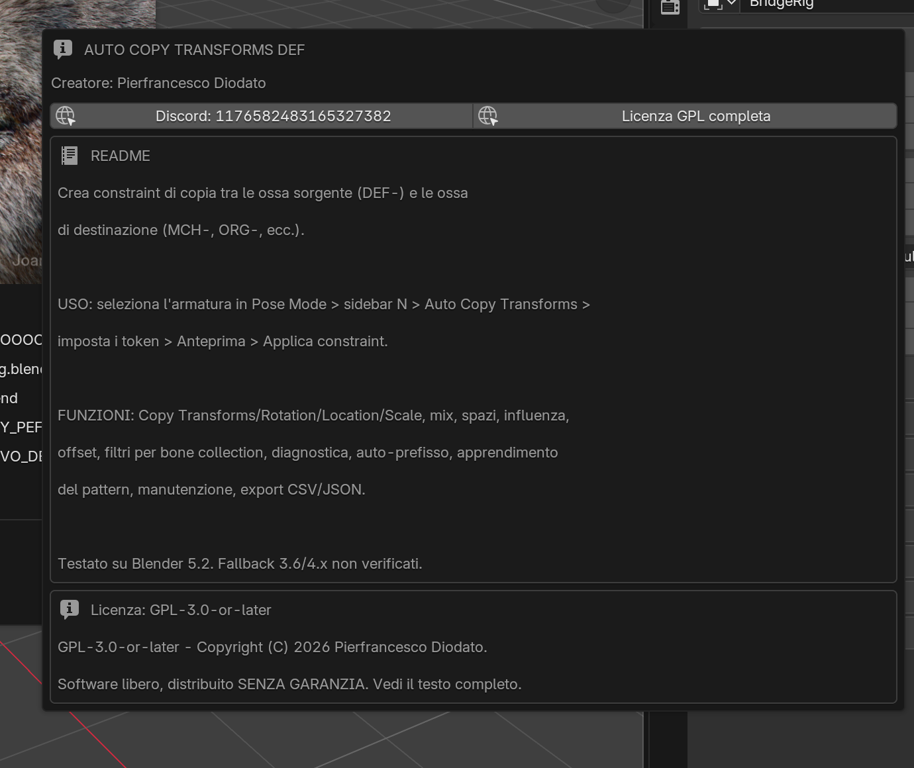

# Auto Copy Transforms DEF

[](https://www.blender.org/)
[](LICENSE)
[]()

**Constraint Copy Transforms automatici per rig Blender.**  
Mappa le ossa sorgente (`DEF-`) sulle ossa di destinazione (`MCH-`, `ORG-`, ...)
e costruisce lo stack di constraint in pochi click.



---

## Perché questo add-on

Nel rigging capita spesso di ripetere la stessa operazione decine di volte:
creare un Copy Transforms su ogni osso di destinazione, puntarlo all'osso
sorgente corrispondente, poi sistemare spazi, influenza e ordine nello stack.

**Auto Copy Transforms DEF** automatizza la parte ripetitiva, lasciando il
risultato ispezionabile e reversibile.

- mappatura dei nomi deterministica
- anteprima prima di applicare
- constraint generati tracciati in un registro JSON
- pulizia che non tocca mai i constraint manuali

---

## Funzioni

| Area | Cosa offre |
|---|---|
| Mappatura | Token prefisso/suffisso, template personalizzati, regex, riconoscimento lati (`L`/`R`) |
| Armatura sorgente | Stessa armatura oppure armatura sorgente separata |
| Tipi di constraint | `COPY_TRANSFORMS`, `COPY_ROTATION`, `COPY_LOCATION`, `COPY_SCALE` |
| Controllo fine | Mix, spazi target/owner, influenza, offset, posizione nello stack, rimozione shear |
| Filtri | Bone collection e solo ossa deform |
| Diagnostica | Controlli pre-flight per target mancanti, orientamento di rest, driver, collection |
| Auto-prefisso | Stima `DEF-` / `MCH-` / `ORG-` dai nomi osso, senza cambiare i default |
| Impara pattern | Legge un constraint di copia esistente e riusa la regola sul resto del rig |
| Manutenzione | Converti in manuali, pulisci registro, mute/unmute dei generati |
| Export | Export di mappatura/registro in CSV o JSON |

L'add-on è un **unico file Python** e non ha dipendenze esterne.

---

## Installazione

### Blender 4.2+ / 5.x — Estensione (consigliata)

1. Scarica `auto_copy_transforms_def-1.1.0.zip`.
2. Apri **Edit → Preferences → Get Extensions**.
3. Clicca la freccia in alto a destra e scegli **Install from Disk...**
4. Seleziona lo ZIP e attiva **Auto Copy Transforms DEF**.

### Blender 3.6 / 4.x — Add-on classico

1. Apri **Edit → Preferences → Add-ons**.
2. Usa **Install from Disk...** e seleziona `auto_copy_transforms_def.py`.
3. Attiva **Rigging: Auto Copy Transforms DEF**.

### Dove si trova

Apri la 3D View, premi `N` e seleziona la scheda **Auto Copy Transforms**.

---

## Uso rapido

1. Seleziona l'armatura di destinazione ed entra in **Pose Mode**.
2. Apri la sidebar: `N → Auto Copy Transforms`.
3. Imposta il token sorgente (`DEF-`) e quello di destinazione (`MCH-`).
4. Clicca **Anteprima** per controllare la mappatura.
5. Clicca **Applica constraint**.
6. Usa **Rimuovi constraint creati** per annullare.

> I default restano volutamente quelli della 1.0.0:
> `COPY_TRANSFORMS`, `DEF-` / `MCH-`.

---

## Tipi di constraint

| Tipo | Copia | Note |
|---|---|---|
| `COPY_TRANSFORMS` | Posizione, rotazione, scala | Default; supporta mix e remove shear |
| `COPY_ROTATION` | Solo rotazione | Caso tipico per ossa deform; supporta mix/offset |
| `COPY_LOCATION` | Solo posizione | Supporta `use_offset` |
| `COPY_SCALE` | Solo scala | Supporta `use_offset` |

`use_offset` viene mostrato solo dove è indipendente dal mix
(Copy Location e Copy Scale). Copy Rotation usa il suo mix nativo `OFFSET`;
Copy Transforms ignora l'opzione con un avviso chiaro.

---

## Pannello Manutenzione

Il sotto-pannello **Manutenzione** tiene sotto controllo i constraint generati:

- **Converti in manuali** — esce dal registro senza toccare i constraint.
- **Pulisci registro** — rimuove voci orfane, tipo non coerente e subtarget mancanti.
- **Mute/Unmute generati** — toggle globale, i constraint manuali non vengono toccati.
- **Export CSV / JSON** — una riga per voce del registro, salvata accanto al `.blend`
  (o nella cartella di lavoro corrente se il file non è ancora salvato).

I constraint generati sono tracciati tramite un registro JSON salvato
sull'armatura, perché i constraint Blender non supportano le ID properties.

---

## Compatibilità

- **Testato:** Blender 5.2 LTS.
- **Fallback presenti ma non testati:** Blender 3.6 / 4.x.
- **Lingua UI:** italiano e inglese, in base alla lingua dell'interfaccia Blender.
- **Documentazione:** inglese e italiano.

La suite copre operatori, mappatura, tipi di constraint, diagnostica,
auto-prefisso, apprendimento del pattern, manutenzione ed export. La UI viene
verificata a mano perché i test headless non possono cliccare l'interfaccia.

---

## Sviluppo

Il progetto tiene l'add-on in un unico file:

```text
actd_build/auto_copy_transforms_def.py
```

Le suite di regressione stanno accanto:

```text
test_mod1.py            armatura sorgente
test_mod2.py            mix mode e posizione nello stack
test_mod3.py            filtro bone collection
test_mod4.py            diagnostica
test_actd.py            suite end-to-end storica
test_mod_types.py       tipi di constraint e use_offset
test_mod_autoprefix.py  riconoscimento automatico dei token
test_mod_learn.py       impara il pattern da un constraint
test_mod6.py            manutenzione ed export
test_i18n.py            traduzioni UI italiano/inglese
test_func1.py           verifica funzionale della copia
```

Esegui una suite con l'eseguibile completo di Blender:

```powershell
& 'C:\Program Files\Blender Foundation\Blender 5.2\blender.exe' `
  --background --factory-startup --python actd_build\test_actd.py
```

Stato attuale: **381 controlli, 0 falliti** su Blender 5.2.

### Costruire l'estensione

La cartella `packaging` contiene manifest, README del pacchetto e uno script
di build in un comando:

```powershell
powershell -NoProfile -ExecutionPolicy Bypass `
  -File packaging\build_extension.ps1
```

Crea `dist/auto_copy_transforms_def-1.1.0.zip` ed esegue il validatore delle
estensioni Blender. Usa `-Blender <path>` per indicare un altro eseguibile.

---

## Licenza

Questo progetto è software libero, distribuito con
**GNU General Public License v3.0 o successiva**.

Vedi [LICENSE](LICENSE) per il testo completo.

Copyright (C) 2026 **Pierfrancesco Diodato**.

---

## Autore

**Pierfrancesco Diodato**

- Discord: [1176582483165327382](https://discord.com/users/1176582483165327382)

Se usi l'add-on in un rig di produzione, feedback e segnalazioni sono
benvenuti.
