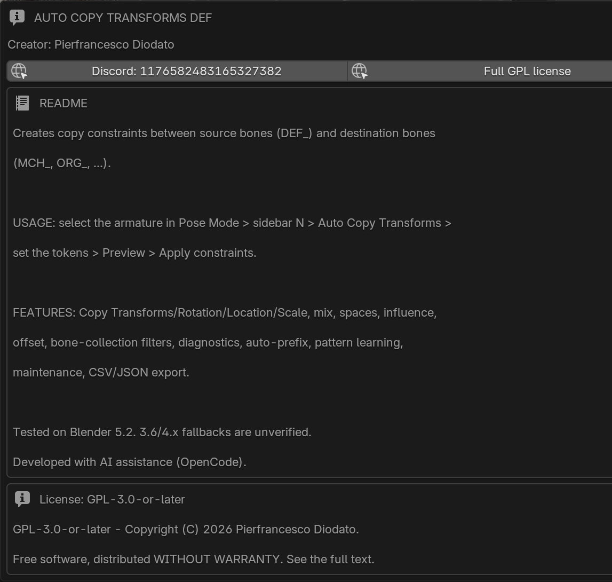
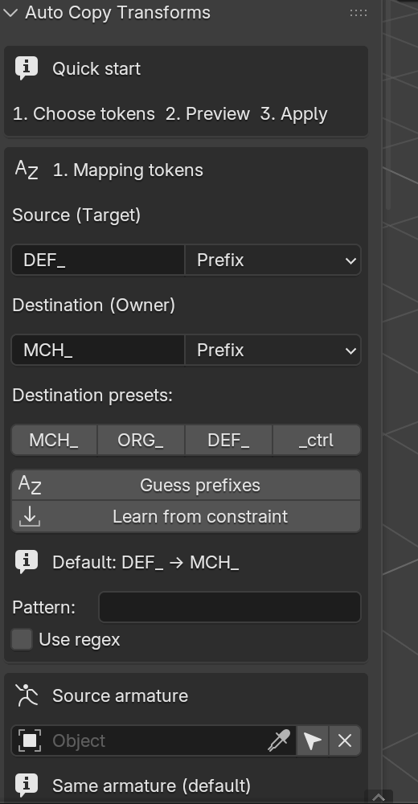
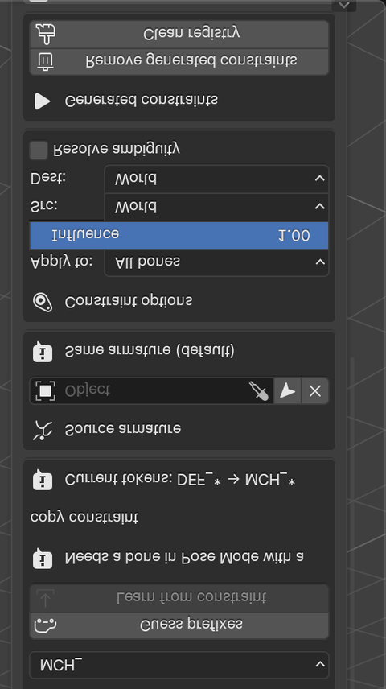
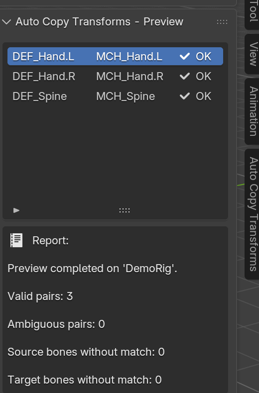
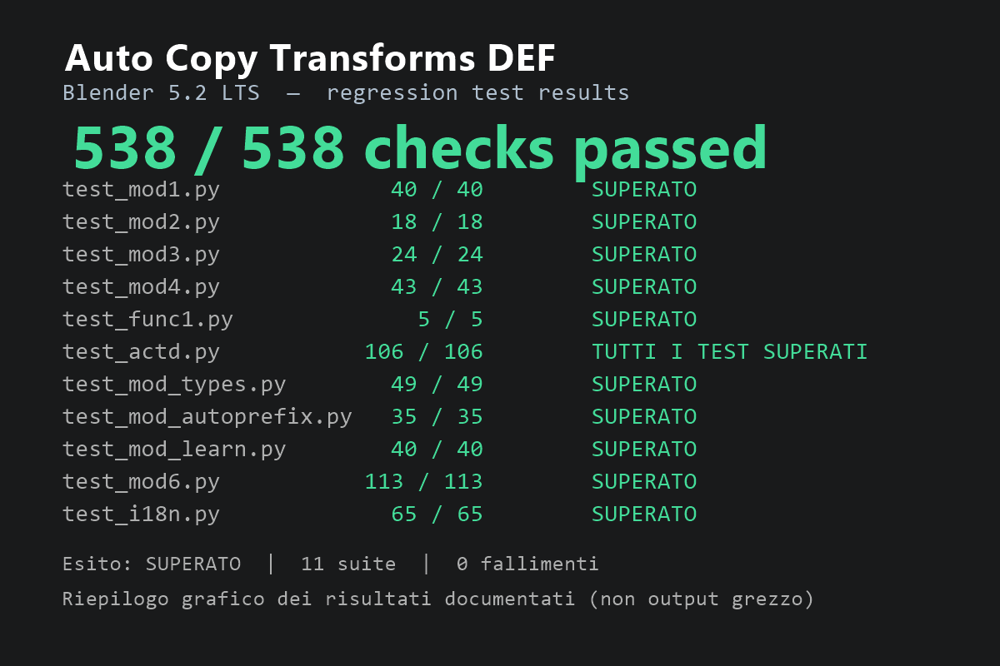

# Auto Copy Transforms DEF

[](https://www.blender.org/)
[](LICENSE)
[]()

**Automatic Copy Transforms constraints for Blender rigs.**  
Automate the creation of Copy Transforms constraints between armatures in a
few clicks and save hours of repetitive rigging work.

Map source bones (`DEF_`) to destination bones (`MCH_`, `ORG_`, ...) and build
the constraint stack in a few clicks.

[Download v1.1.5](https://github.com/PieroFra/auto-copy-transforms-def/releases/tag/v1.1.5) · [Issues](https://github.com/PieroFra/auto-copy-transforms-def/issues)



---

## Why this add-on

Rigging often means repeating the same operation dozens of times: create a
Copy Transforms constraint on every destination bone, point it at the matching
source bone, then fix spaces, influence and stack order.

**Auto Copy Transforms DEF** does the repetitive part for you, while keeping
the result inspectable and reversible.

- deterministic name mapping
- preview before applying
- generated constraints tracked in a JSON registry
- cleanup that never touches manual constraints

---

## Features

| Area | What you get |
|---|---|
| Mapping | Prefix/suffix tokens, custom templates, regex, automatic side detection (`L`/`R`) |
| Source rig | Use the same armature or a separate source armature |
| Constraint types | `COPY_TRANSFORMS`, `COPY_ROTATION`, `COPY_LOCATION`, `COPY_SCALE` |
| Fine control | Mix mode, target/owner space, influence, offset, stack position, remove shear |
| Filters | Bone collections and deform-only bones |
| Diagnostics | Pre-flight checks for missing targets, rest orientation, drivers, collections |
| Auto-prefix | Guesses likely prefixes such as `DEF_` / `MCH_` / `ORG_` from bone names, never silently changing defaults |
| Learn pattern | Reads an existing copy constraint and reuses its rule on the rest of the rig |
| Maintenance | Convert generated constraints to manual, clean the registry, mute/unmute generated constraints |
| Export | Mapping/registry export to CSV or JSON |

The add-on is a **single Python file** and has no external dependencies.

---

## Installation

### Blender 4.2+ / 5.x — Extension (recommended)

1. Download `auto_copy_transforms_def-1.1.5.zip`.
2. Open **Edit → Preferences → Get Extensions**.
3. Click the arrow in the top-right corner and choose **Install from Disk...**
4. Select the ZIP and enable **Auto Copy Transforms DEF**.

### Blender 4.2+ / 5.x — Legacy add-on

1. Open **Edit → Preferences → Add-ons**.
2. Use **Install from Disk...** and select `auto_copy_transforms_def.py`.
3. Enable **Rigging: Auto Copy Transforms DEF**.

The standalone file ships in the companion RAR under `legacy/`; it is not
included in the extension ZIP.

### Where to find it

Open the 3D View, press `N`, and select the **Auto Copy Transforms** tab.

---

## Quick start

1. Select the destination armature and enter **Pose Mode**.
2. Open the sidebar: `N → Auto Copy Transforms`.
3. Set the source token (`DEF_`) and destination token (`MCH_`).
4. Click **Preview** to inspect the mapping.
5. Click **Apply constraints**.
6. Use **Remove generated constraints** to undo the operation.

> Defaults: `COPY_TRANSFORMS`, tokens `DEF_` / `MCH_`.

---

## How it works

### 1. Choose the tokens



The main panel is organized in three steps: tokens, constraint options and
actions. The quick-start box always shows the flow: **choose tokens → preview →
apply**.



### 2. Check the mapping



The preview lists every `DEF_` → `MCH_` pair with its status. Nothing is
applied until you click **Apply constraints**.

### 3. Apply and verify

The preview report confirms the number of valid pairs and the generated
constraints are tracked in the JSON registry. The regression suite verifies
the same behavior on Blender 5.2 (see below).

---

## Constraint types

| Type | Copies | Notes |
|---|---|---|
| `COPY_TRANSFORMS` | Location, rotation, scale | Default; supports mix and remove shear |
| `COPY_ROTATION` | Rotation only | Common for deform bones; supports mix/offset |
| `COPY_LOCATION` | Location only | Supports `use_offset` |
| `COPY_SCALE` | Scale only | Supports `use_offset` |

`use_offset` is exposed only where it is independent from the mix setting
(Copy Location and Copy Scale). Copy Rotation uses its native `OFFSET` mix
mode; Copy Transforms ignores the option with a clear warning.

---

## Maintenance panel

The **Maintenance** sub-panel keeps the generated constraints under control:

- **Convert to manual** — remove constraints from the registry without touching them.
- **Clean registry** — drop orphan entries, type mismatches and missing subtargets.
- **Mute/Unmute generated** — global toggle, manual constraints are never touched.
- **Export CSV / JSON** — one row per registry entry, saved next to the `.blend`
  (or in the current working directory if the file is not saved yet).

Generated constraints are tracked through a JSON registry stored on the
armature object, because Blender constraints do not support ID properties.

---

## Compatibility

- **Tested officially: Blender 5.2 LTS only.**
- **Declared compatibility: Blender 4.2+** for both installation paths (legacy
  add-on and extension manifest). Blender 4.2–5.1 are declared compatible but
  have not been tested with the full regression suite.
- **UI language:** Italian and English, following Blender's interface language.
- **Documentation:** English and Italian.

The test suite covers operators, mapping, constraint types, diagnostics,
auto-prefix, pattern learning, maintenance and exports. GUI drawing is tested
manually because headless tests cannot click the interface.

---

## Known limitations

- **Blender 4.2–5.1 are declared compatible but have not been tested
  officially.** The official regression environment is Blender 5.2 LTS.
- **Headless tests do not replace a full interactive GUI check:** the
  regression suites verify behavior and logic, but the interface has been
  verified manually on Blender 5.2 only.
- **Generated constraints use an internal JSON registry:** Blender constraints
  do not support ID properties, so generated constraints are tracked via a
  registry stored on the armature object. Removing or renaming them manually
  outside the Maintenance panel can leave orphan entries (removable via
  **Clean registry**).

---

## Development

The project keeps the add-on in a single file:

```text
actd_build/auto_copy_transforms_def.py
```

This is the main (legacy) add-on file and the single source of truth. The
install packages contain a copy of it: the extension ZIP ships it as the
extension module, while the companion RAR ships it under `legacy/`.

Regression suites live next to it:

```text
test_mod1.py            source armature
test_mod2.py            mix mode and stack position
test_mod3.py            bone-collection filter
test_mod4.py            diagnostics
test_actd.py            historical end-to-end suite
test_mod_types.py       constraint types and use_offset
test_mod_autoprefix.py  automatic token detection
test_mod_learn.py       learn pattern from a constraint
test_mod6.py            maintenance and exports
test_i18n.py            Italian/English UI translations
test_func1.py           functional copy check
```

Run the canonical sequential audit (all 11 suites, with each `test_out.txt`
checked and the expected per-suite counts enforced):

```powershell
powershell -NoProfile -ExecutionPolicy Bypass `
  -File actd_build\run_all_tests.ps1
```

The runner uses `C:\Program Files\Blender Foundation\Blender 5.2\blender.exe`
by default; pass `-Blender <path>` to use another executable. For one suite,
invoke Blender directly, for example:

```powershell
& 'C:\Program Files\Blender Foundation\Blender 5.2\blender.exe' `
  --background --factory-startup --python actd_build\test_actd.py
```

Audit status: **538/538 checks passed, 0 failures** on Blender 5.2. The runner
expects: `test_mod1.py` 40, `test_mod2.py` 18, `test_mod3.py` 24,
`test_mod4.py` 43, `test_func1.py` 5, `test_actd.py` 106,
`test_mod_types.py` 49, `test_mod_autoprefix.py` 35,
`test_mod_learn.py` 40, `test_mod6.py` 113 and `test_i18n.py` 65. The suites
report `SUPERATO` (the historical `test_actd.py` reports
`TUTTI I TEST SUPERATI`). The first four suites total 125/125.



Full results table: [docs/TEST_RESULTS.md](docs/TEST_RESULTS.md). The image
above is a graphical summary, not raw test output.  
Release checklist: [docs/RELEASE_CHECKLIST.md](docs/RELEASE_CHECKLIST.md).

### Build the extension

The `packaging` folder contains the manifest, package READMEs and the ZIP
builder:

```powershell
powershell -NoProfile -ExecutionPolicy Bypass `
  -File packaging\build_extension.ps1
```

It creates `dist/auto_copy_transforms_def-1.1.5.zip` and runs Blender's
extension validator. Pass `-Blender <path>` to use a different Blender
executable. To assemble the ZIP, RAR and SHA256 sidecars locally, run:

```powershell
powershell -NoProfile -ExecutionPolicy Bypass `
  -File packaging\build_release.ps1
```

The release script invokes the ZIP builder and requires a RAR command-line
tool (`rar.exe` or `WinRAR.exe`; use `-Rar <path>` if it is elsewhere). It only
creates local files in `dist/`: it does not publish, create tags, or use Git.

---

## AI disclosure

This add-on and its documentation were developed with **AI assistance**
(OpenCode agent), under the direction and review of **Pierfrancesco Diodato**.
The author remains responsible for the code, tests, and licensing.

---

## License

This project is free software, licensed under the
**GNU General Public License v3.0 or later**.

See [LICENSE](LICENSE) for the full text.

Copyright (C) 2026 **Pierfrancesco Diodato**.

---

## Author

**Pierfrancesco Diodato**

- Discord: [1176582483165327382](https://discord.com/users/1176582483165327382)

If you use the add-on in a production rig, feedback and bug reports are
welcome.
